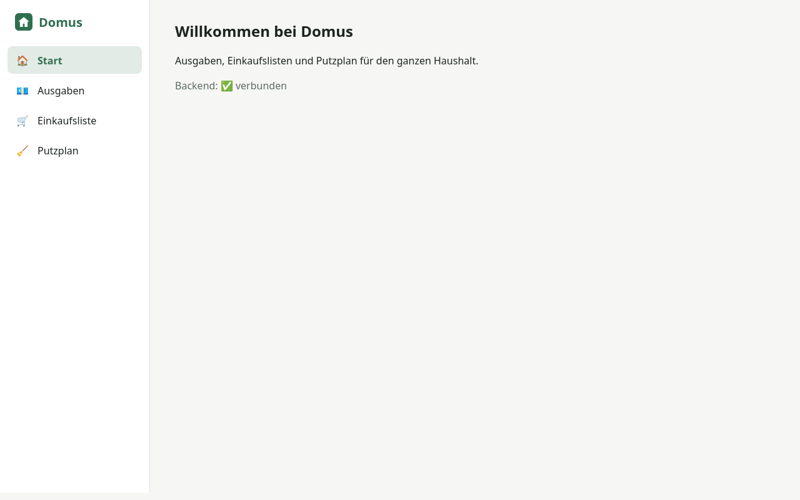
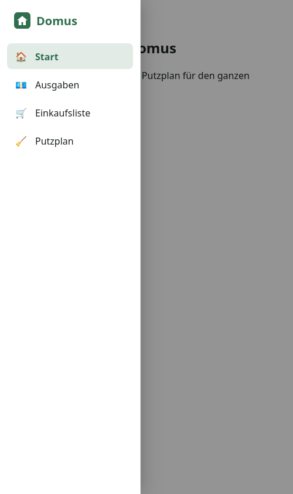

# Domus

**Haushalts-App für alle Mitglieder eines Haushalts: Ausgaben, Einkaufslisten und Putzplan.**
Läuft im Browser und auf dem Handy, wird selbst gehostet (Raspberry Pi), Anmeldung ausschließlich
per **Passkey**: ohne Passwörter.

> Dieses Repository ist das **öffentliche Schaufenster** des Projekts. Der vollständige Quellcode
> liegt in einem privaten Repository; hier finden sich Architektur, Designentscheidungen,
> Screenshots und ausgewählte Code-Auszüge. **Einblick in den vollständigen Code gebe ich gern
> auf Anfrage**, z. B. im Rahmen eines Bewerbungsgesprächs.

  
  

## Technik

| Bereich    | Technik                                                                     |
| ---------- | --------------------------------------------------------------------------- |
| Backend    | Python 3.14, FastAPI, SQLAlchemy 2, Alembic, Pydantic, uv                   |
| Datenbank  | PostgreSQL 18                                                               |
| Frontend   | React 19, TypeScript, Vite, React Router, TanStack Query                    |
| API-Client | aus der OpenAPI-Spezifikation generierte TypeScript-Typen (`openapi-fetch`) |
| Auth       | WebAuthn / Passkeys (`py_webauthn`), serverseitige Sessions                 |
| Qualität   | pytest, Vitest + Testing Library, Ruff, oxlint, Prettier                    |
| Betrieb    | Docker Compose, Ziel: Raspberry Pi (ARM64)                                  |

## Highlights

- **Passkey-only-Authentifizierung**: Registrierung nur per Einladungslink, Anmeldung ohne
  Benutzername (Discoverable Credentials), mehrere Passkeys pro Person, Kontowiederherstellung
  über einmalige, zeitlich begrenzte Links per CLI. → [Details](docs/authentifizierung.md)
- **Echte End-to-End-Tests der Passkey-Abläufe**: ein selbst geschriebener
  [Software-Authenticator](code/backend/tests/softauthn.py) erzeugt kryptografisch gültige
  WebAuthn-Antworten, die das Backend genauso prüft wie die eines echten Geräts.
- **Sicherheit by Design**: Tokens und Session-IDs werden nur als SHA-256-Hash gespeichert,
  Challenges sind einmalig verwendbar, Cookies `HttpOnly` + `SameSite=Lax`, Prüfung von
  Origin und RP-ID.
- **Typsicherheit über die API-Grenze hinweg**: Das Frontend nutzt Typen, die direkt aus der
  OpenAPI-Spezifikation des Backends erzeugt werden.
- **Mobile first**: Sidebar am Desktop, ausklappbares Menü am Handy, Safe-Area-Unterstützung,
  Hell-/Dunkelmodus.
- **Lizenz-Compliance automatisiert**: Jeder Build prüft die Lizenzen aller Abhängigkeiten und
  erzeugt die Lizenzhinweise (`THIRD_PARTY_LICENSES.txt`) automatisch.
  → [Skript](code/scripts/licenses.sh)

## Screenshots

| Desktop                                                                                | Handy                                                                                    | Handy mit Menü                                                                               |
| -------------------------------------------------------------------------------------- | ---------------------------------------------------------------------------------------- | -------------------------------------------------------------------------------------------- |
|  |  |  |

**API-Dokumentation** (automatisch aus dem Code erzeugt, OpenAPI 3.1):

## Inhalt dieses Repositorys

| Pfad                                                   | Inhalt                                               |
| ------------------------------------------------------ | ---------------------------------------------------- |
| [docs/architektur.md](docs/architektur.md)             | Aufbau, Komponenten, Datenmodell                     |
| [docs/authentifizierung.md](docs/authentifizierung.md) | Passkey-Abläufe mit Sequenzdiagrammen                |
| [docs/entscheidungen.md](docs/entscheidungen.md)       | Wichtige Designentscheidungen und ihre Begründung    |
| [code/](code/)                                         | Ausgewählte Code-Auszüge aus dem privaten Repository |
| [docs/screenshots/](docs/screenshots/)                 | Screenshots                                          |

## Projektstand

| Bereich                                | Stand               |
| -------------------------------------- | ------------------- |
| Projektgerüst, Docker-Setup, Tests     | ✅ fertig           |
| Passkey-Authentifizierung (Backend)    | ✅ fertig, getestet |
| Layout & Navigation (Frontend)         | ✅ fertig           |
| Login im Frontend                      | 🔜 als Nächstes     |
| Einkaufsliste, Ausgaben, Putzplan      | 🔜 geplant          |
| PWA (installierbar, offline-fähig)     | 🔜 geplant          |
| Betrieb auf dem Raspberry Pi mit HTTPS | 🔜 geplant          |

## Entwicklung

Domus entsteht mit Unterstützung von [Claude Code](https://claude.com/claude-code)
(KI-Assistent). Anforderungen, Architektur- und Technologieentscheidungen, Lizenz- und
Sicherheitskonzept sowie das Review des Codes liegen bei mir.

## Lizenz

Copyright © 2026 Tobias Bittermann. **Nicht Open Source.** Die Inhalte dieses Repositorys stehen
unter der [PolyForm Free Trial License 1.0.0](LICENSE) und dienen ausschließlich der Ansicht und
Bewertung.
