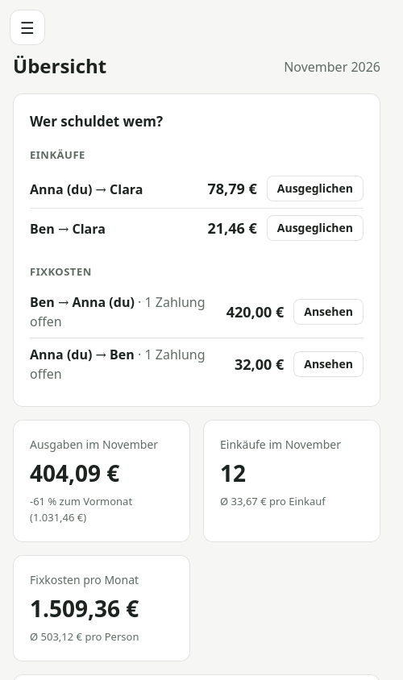
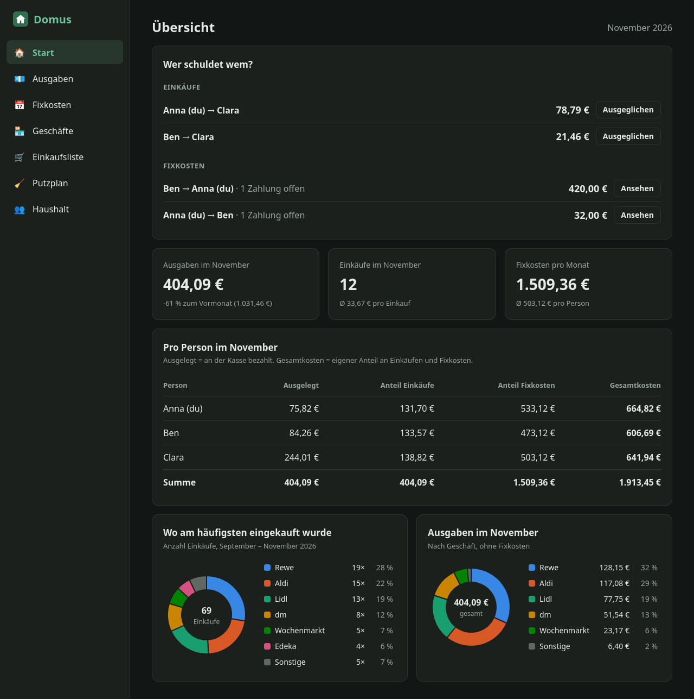
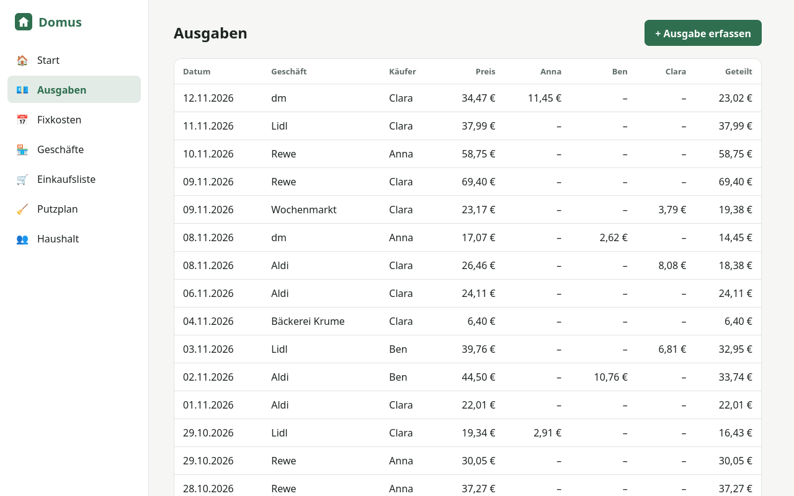
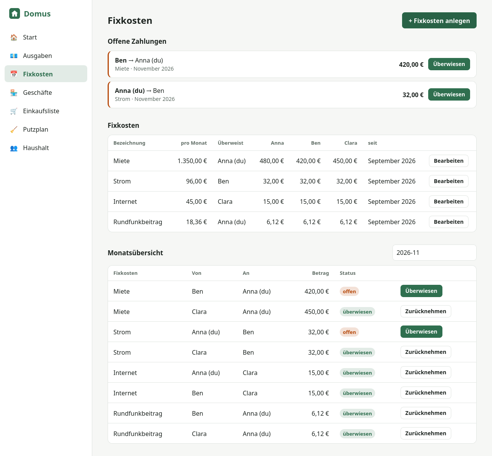
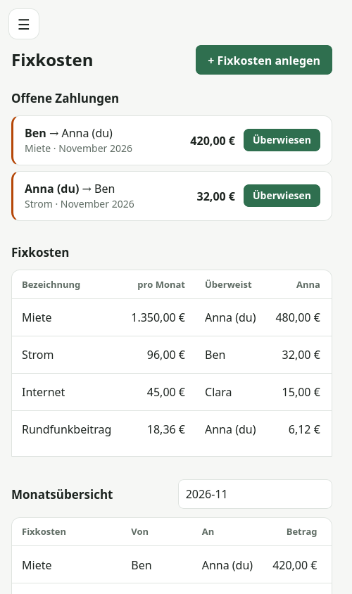
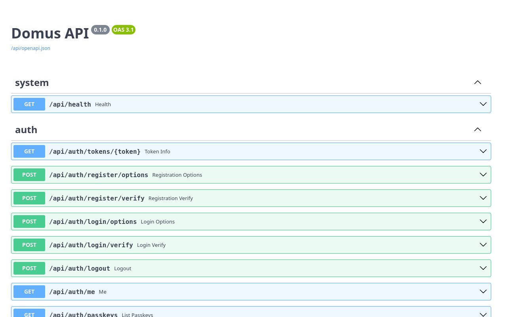

# Domus

**Haushalts-App für alle Mitglieder eines Haushalts: gemeinsame Ausgaben, Fixkosten,
Einkaufslisten und Putzplan.**
Läuft im Browser und auf dem Handy, wird selbst gehostet (Raspberry Pi), Anmeldung ausschließlich
per **Passkey**: ohne Passwörter.

> Dieses Repository ist das **öffentliche Schaufenster** des Projekts. Der vollständige Quellcode
> liegt in einem privaten Repository; hier finden sich Architektur, Designentscheidungen,
> Screenshots und ausgewählte Code-Auszüge. **Einblick in den vollständigen Code gebe ich gern
> auf Anfrage**, z. B. im Rahmen eines Bewerbungsgesprächs.

  
  

## Funktionen

- **Ausgaben erfassen:** Kassenzettel im Stapel abtippen, mit persönlichen Anteilen einzelner
  Personen; der Rest wird Cent-genau auf alle aufgeteilt.
- **Wer schuldet wem?** Aus allen Einkäufen berechnet Domus die minimale Anzahl an Überweisungen;
  ein Klick auf „Ausgeglichen“ verbucht die Zahlung.
- **Fixkosten:** Miete, Strom, Internet mit individuellen Anteilen; jedes Mitglied bestätigt pro
  Monat seine Überweisung an den Zahler, offene Monate werden gesammelt angezeigt.
- **Startseite:** offene Schulden, Kennzahlen mit Vormonatsvergleich, Kosten pro Person,
  Ringdiagramme nach Geschäft.
- **Haushalt:** Mitglieder und Geschäfte verwalten. Ein Mitglied ist zunächst nur ein Name und
  kann später per Einladungslink mit einem eigenen Passkey-Konto verknüpft werden.

→ Fachlogik und Rechenweg im Detail: [docs/finanzen.md](docs/finanzen.md)

## Technik

| Bereich    | Technik                                                                     |
| ---------- | --------------------------------------------------------------------------- |
| Backend    | Python 3.14, FastAPI, SQLAlchemy 2, Alembic, Pydantic, uv                   |
| Datenbank  | PostgreSQL 18                                                               |
| Frontend   | React 19, TypeScript, Vite, React Router, TanStack Query                    |
| API-Client | aus der OpenAPI-Spezifikation generierte TypeScript-Typen (`openapi-fetch`) |
| Auth       | WebAuthn / Passkeys (`py_webauthn`), serverseitige Sessions                 |
| Qualität   | pytest, Vitest + Testing Library, Ruff, oxlint, Prettier                    |
| Betrieb    | Docker Compose, Ziel: Raspberry Pi (ARM64)                                  |

## Highlights

- **Saubere Geldbeträge:** alles in ganzen Cent, Aufteilung ohne Rundungsverluste, Prüfungen
  doppelt abgesichert (Pydantic + `CHECK`-Constraints in PostgreSQL). Bestätigte Fixkosten
  speichern ihren damaligen Betrag, damit spätere Preisänderungen die Historie nicht verfälschen.
  → [Fachlogik](docs/finanzen.md)
- **Minimale Überweisungen:** Salden aller Mitglieder werden per Greedy-Verfahren mit höchstens
  _n − 1_ Überweisungen ausgeglichen. → [Code](code/backend/services/dashboard.py)
- **Passkey-only-Authentifizierung:** Registrierung nur per Einladungslink, Anmeldung ohne
  Benutzername (Discoverable Credentials), mehrere Passkeys pro Person, Kontowiederherstellung
  über einmalige, zeitlich begrenzte Links per CLI. → [Details](docs/authentifizierung.md)
- **Echte End-to-End-Tests der Passkey-Abläufe:** ein selbst geschriebener
  [Software-Authenticator](code/backend/tests/softauthn.py) erzeugt kryptografisch gültige
  WebAuthn-Antworten, die das Backend genauso prüft wie die eines echten Geräts.
- **Sicherheit by Design:** Tokens und Session-IDs werden nur als SHA-256-Hash gespeichert,
  Challenges sind einmalig verwendbar, Cookies `HttpOnly` + `SameSite=Lax`, Prüfung von
  Origin und RP-ID; jede Anfrage ist auf den eigenen Haushalt beschränkt (per Test abgesichert).
- **Typsicherheit über die API-Grenze hinweg:** Das Frontend nutzt Typen, die direkt aus der
  OpenAPI-Spezifikation des Backends erzeugt werden.
- **Barrierearme, eigene Diagramme:** Ringdiagramme als SVG-Komponente ohne Chart-Bibliothek,
  Legende als Tabelle, konsistente Farben pro Geschäft, Hell-/Dunkelmodus.
  → [DonutChart.tsx](code/frontend/DonutChart.tsx)
- **Mobile first:** Sidebar am Desktop, ausklappbares Menü am Handy, Dialoge auf Basis von
  `<dialog>`, Safe-Area-Unterstützung.
- **Lizenz-Compliance automatisiert:** Jeder Build prüft die Lizenzen aller Abhängigkeiten und
  erzeugt die Lizenzhinweise (`THIRD_PARTY_LICENSES.txt`) automatisch.
  → [Skript](code/scripts/licenses.sh)
- **Getestet:** 44 Backend-Tests gegen eine echte PostgreSQL-Datenbank, 33 Frontend-Tests mit
  Vitest und Testing Library.

## Screenshots

Alle Screenshots zeigen fiktive Demodaten.

**Startseite** – hell und dunkel:

| Hell                                                                                     | Dunkel                                                                                          |
| ---------------------------------------------------------------------------------------- | ----------------------------------------------------------------------------------------------- |
|  |  |

**Ausgaben und Fixkosten:**

| Ausgaben-Liste                                                                           | Kassenzettel erfassen                                                                                      | Fixkosten                                                                                             |
| ---------------------------------------------------------------------------------------- | ---------------------------------------------------------------------------------------------------------- | ----------------------------------------------------------------------------------------------------- |
|  |  |  |

**Auf dem Handy:**

| Startseite                                                                               | Menü                                                                                         | Fixkosten                                                                                     |
| ---------------------------------------------------------------------------------------- | -------------------------------------------------------------------------------------------- | --------------------------------------------------------------------------------------------- |
|  |  |  |

**API-Dokumentation** (automatisch aus dem Code erzeugt, OpenAPI 3.1):

## Inhalt dieses Repositorys

| Pfad                                                   | Inhalt                                                   |
| ------------------------------------------------------ | -------------------------------------------------------- |
| [docs/finanzen.md](docs/finanzen.md)                   | Ausgaben, Abrechnung, Fixkosten und Startseite im Detail |
| [docs/architektur.md](docs/architektur.md)             | Aufbau, Komponenten, Datenmodell                         |
| [docs/authentifizierung.md](docs/authentifizierung.md) | Passkey-Abläufe mit Sequenzdiagrammen                    |
| [docs/entscheidungen.md](docs/entscheidungen.md)       | Wichtige Designentscheidungen und ihre Begründung        |
| [code/](code/)                                         | Ausgewählte Code-Auszüge aus dem privaten Repository     |
| [docs/screenshots/](docs/screenshots/)                 | Screenshots                                              |

## Projektstand

| Bereich                                     | Stand                                      |
| ------------------------------------------- | ------------------------------------------ |
| Projektgerüst, Docker-Setup, Tests          | ✅ fertig                                  |
| Passkey-Authentifizierung (Backend)         | ✅ fertig, getestet – vorerst abgeschaltet |
| Layout & Navigation (Frontend)              | ✅ fertig                                  |
| Haushalt, Mitglieder, Geschäfte             | ✅ fertig                                  |
| Ausgaben mit persönlichen Anteilen          | ✅ fertig                                  |
| Fixkosten mit monatlicher Bestätigung       | ✅ fertig                                  |
| Startseite: Schulden, Ausgleich, Kennzahlen | ✅ fertig                                  |
| Login im Frontend, Anmeldung einschalten    | 🔜 als Nächstes                            |
| Einkaufsliste, Putzplan                     | 🔜 geplant                                 |
| PWA (installierbar, offline-fähig)          | 🔜 geplant                                 |
| Betrieb auf dem Raspberry Pi mit HTTPS      | 🔜 geplant                                 |

## Entwicklung

Domus entsteht mit Unterstützung von [Claude Code](https://claude.com/claude-code)
(KI-Assistent). Anforderungen, Architektur- und Technologieentscheidungen, Lizenz- und
Sicherheitskonzept sowie das Review des Codes liegen bei mir.

## Lizenz

Copyright © 2026 Tobias Bittermann. **Nicht Open Source.** Die Inhalte dieses Repositorys stehen
unter der [PolyForm Free Trial License 1.0.0](LICENSE) und dienen ausschließlich der Ansicht und
Bewertung.
