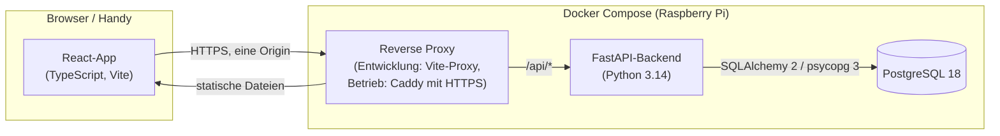
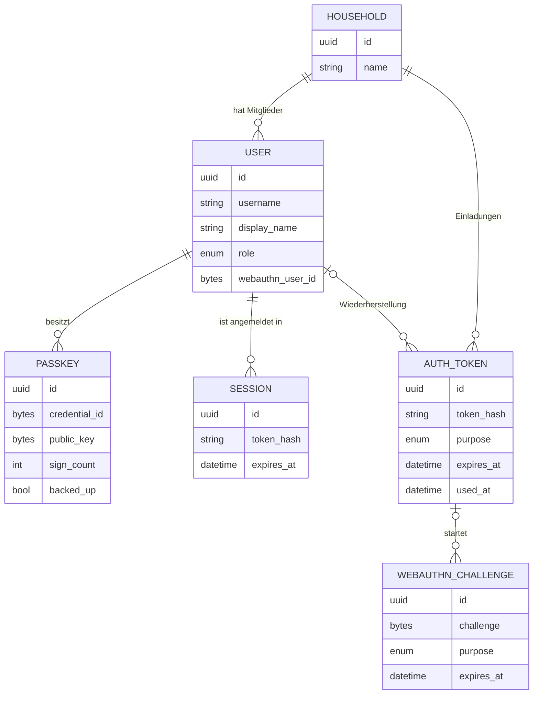

# Architektur

## Überblick



Frontend und API laufen bewusst **unter derselben Origin**: Der Proxy liefert die React-App aus und
leitet `/api` an das Backend weiter. Dadurch entfallen CORS-Konfiguration und Cross-Site-Cookies,
und Passkeys sind an genau eine Domain gebunden.

## Backend

```
backend/
├── app/
│   ├── api/            # Router und Abhängigkeiten (aktueller Benutzer, DB-Session)
│   ├── core/           # Konfiguration (pydantic-settings), DB-Engine, Krypto-Helfer
│   ├── models/         # SQLAlchemy-Modelle, nach Fachbereich sortiert
│   │   ├── common/     #   Mixins, Spaltentypen
│   │   ├── household/  #   Haushalt, Mitglieder, Rollen
│   │   └── auth/       #   Passkeys, Sessions, Einladungs-Tokens, Challenges
│   ├── services/       # Fachlogik, unabhängig von HTTP
│   ├── schemas.py      # Pydantic-Modelle für Requests/Responses
│   └── cli.py          # Verwaltungsbefehle (Typer)
├── alembic/            # Datenbank-Migrationen
└── tests/              # pytest gegen echte PostgreSQL-Testdatenbank
```

- **Schichten:** Router sind dünn und rufen Services auf; die Fachlogik ist ohne HTTP testbar.
- **Migrationen:** Alembic mit Autogenerate und festen Namenskonventionen für Constraints; der
  Container wendet ausstehende Migrationen beim Start an.
- **Tests:** laufen gegen eine echte PostgreSQL-Datenbank (keine SQLite-Abkürzung), jede Tabelle
  wird nach jedem Test geleert.

## Datenmodell



Alle fachlichen Daten (Listen, Ausgaben, Aufgaben) hängen künftig am **Haushalt**. Damit ist von
Anfang an klar abgegrenzt, wer welche Daten sieht, und mehrere Haushalte sind möglich.

## Frontend

- **React Router** für die Navigation, **TanStack Query** für Server-Zustand (Caching,
  Ladezustände, Fehler).
- **Typisierter API-Client:** `npm run generate:api` erzeugt aus der OpenAPI-Spezifikation des
  Backends TypeScript-Typen; Änderungen an der API fallen so schon beim Kompilieren auf.
- **Layout:** feste Sidebar ab Tablet-Breite, auf dem Handy ein ausklappbares Menü
  (Escape, Klick daneben und Seitenwechsel schließen es), Hell-/Dunkelmodus über
  `prefers-color-scheme`.

## Entwicklung & Betrieb

- `docker compose up` startet Datenbank, Backend (mit Auto-Reload) und Vite-Dev-Server.
- Das Backend-Image wird mit `uv` gebaut; Abhängigkeiten liegen in einer eigenen Schicht und
  bleiben im Cache, solange sich das Lockfile nicht ändert.
- Ziel ist ein Raspberry Pi: alle Images sind ARM64-fähig, HTTPS über Caddy.
