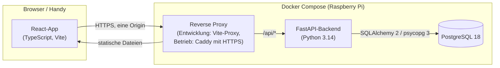
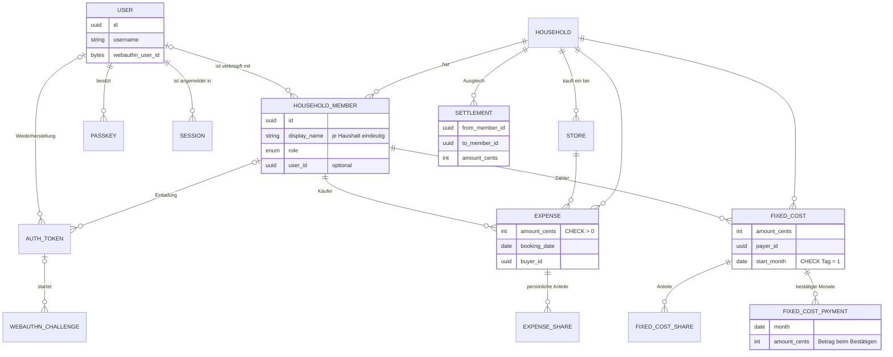

# Architektur

## Überblick



Frontend und API laufen bewusst **unter derselben Origin**: Der Proxy liefert die React-App aus und
leitet `/api` an das Backend weiter. Dadurch entfallen CORS-Konfiguration und Cross-Site-Cookies,
und Passkeys sind an genau eine Domain gebunden.

## Backend

```
backend/
├── app/
│   ├── api/            # Router und Abhängigkeiten (aktueller Benutzer, DB-Session)
│   ├── core/           # Konfiguration (pydantic-settings), DB-Engine, Krypto-Helfer
│   ├── models/         # SQLAlchemy-Modelle, nach Fachbereich sortiert
│   │   ├── common/       #   Mixins, Spaltentypen
│   │   ├── household/    #   Haushalt, Mitglieder, Konten, Rollen
│   │   ├── auth/         #   Passkeys, Sessions, Einladungs-Tokens, Challenges
│   │   ├── expenses/     #   Geschäfte, Ausgaben, persönliche Anteile, Ausgleichszahlungen
│   │   └── fixed_costs/  #   Fixkosten, Anteile, bestätigte Monatszahlungen
│   ├── services/       # Fachlogik, unabhängig von HTTP (auth, household, expenses,
│   │                   #   fixed_costs, dashboard)
│   ├── schemas.py      # Pydantic-Modelle für Requests/Responses
│   └── cli.py          # Verwaltungsbefehle (Typer)
├── alembic/            # Datenbank-Migrationen
└── tests/              # pytest gegen echte PostgreSQL-Testdatenbank
```

- **Schichten:** Router sind dünn und rufen Services auf; die Fachlogik ist ohne HTTP testbar.
  Services werfen fachliche Fehler (`ExpenseError`, `AlreadyConfirmedError` …), die Router in
  passende HTTP-Statuscodes (404, 409, 422) übersetzen.
- **Mandantentrennung:** Jede Anfrage läuft im Kontext eines Haushaltsmitglieds
  (`CurrentMember`-Dependency, [deps.py](../code/backend/api/deps.py)). Services prüfen, dass
  alle referenzierten Mitglieder, Geschäfte und Fixkosten zu diesem Haushalt gehören.
- **Anmeldung per Schalter:** Solange `AUTH_ENABLED=false` ist, handelt jede Anfrage als ältestes
  Mitglied des einzigen Haushalts. Die Passkey-Anmeldung ist fertig und getestet, wird aber erst
  erzwungen, wenn der Schalter umgelegt wird; die Fachlogik merkt davon nichts.
- **Migrationen:** Alembic mit Autogenerate und festen Namenskonventionen für Constraints; der
  Container wendet ausstehende Migrationen beim Start an.
- **Tests:** laufen gegen eine echte PostgreSQL-Datenbank (keine SQLite-Abkürzung), jede Tabelle
  wird nach jedem Test geleert.

## Datenmodell

Zentrale Idee: **Konto und Mitglied sind getrennt.** Ein _Mitglied_ ist eine Person im Haushalt
und kann sofort in Ausgaben und Fixkosten vorkommen, auch ohne eigenes Login. Ein _Konto_ (User)
mit Passkeys wird erst über einen Einladungslink mit dem Mitglied verknüpft. So kann ein Haushalt
loslegen, bevor alle ein Konto haben, und ein Konto kann später mehreren Haushalten angehören.



- **Alle fachlichen Daten hängen am Haushalt.** Damit ist klar abgegrenzt, wer welche Daten
  sieht, und mehrere Haushalte sind möglich.
- **Integrität in der Datenbank:** `CHECK`-Constraints (Beträge > 0, Startmonat immer der 1.,
  Ausgleich nie an sich selbst), eindeutige Namen je Haushalt, `ON DELETE RESTRICT` für Mitglieder,
  auf die noch Buchungen verweisen.
- **Nichts Abgeleitetes wird gespeichert:** Salden, Schulden und Fälligkeiten werden aus den
  Buchungen berechnet, so dass sie nie auseinanderlaufen können.
- Details zur Fachlogik: [finanzen.md](finanzen.md); Details zu den Auth-Tabellen:
  [authentifizierung.md](authentifizierung.md).

## Frontend

```
src/
├── api/          # generierte OpenAPI-Typen, typisierter Client, TanStack-Query-Hooks
├── components/   # Layout, Modal, Formulare, dashboard/ (Diagramme, Karten)
├── pages/        # Start, Ausgaben, Fixkosten, Geschäfte, Haushalt (+ Tests)
└── router.tsx
```

- **React Router** für die Navigation, **TanStack Query** für Server-Zustand (Caching,
  Ladezustände, Fehler). Nach Änderungen werden die betroffenen Abfragen invalidiert, so dass
  z. B. die Startseite nach einer neuen Ausgabe sofort aktuelle Salden zeigt.
- **Typisierter API-Client:** `npm run generate:api` erzeugt aus der OpenAPI-Spezifikation des
  Backends TypeScript-Typen; Änderungen an der API fallen so schon beim Kompilieren auf.
- **Ersteinrichtung:** Gibt es noch keinen Haushalt, zeigt ein `HouseholdGate` statt der Seiten
  einen Einrichtungsdialog (Name des Haushalts und eigener Name).
- **Dialoge** basieren auf dem nativen `<dialog>`-Element: Fokusfalle, Escape und Hintergrund
  ohne zusätzliche Bibliothek.
- **Diagramme** sind eigene SVG-Komponenten statt einer Chart-Bibliothek (kleines Bundle, volle
  Kontrolle über Barrierefreiheit und Farben).
- **Layout:** feste Sidebar ab Tablet-Breite, auf dem Handy ein ausklappbares Menü
  (Escape, Klick daneben und Seitenwechsel schließen es), Hell-/Dunkelmodus über
  `prefers-color-scheme`; breite Tabellen scrollen auf dem Handy horizontal.
- **Tests:** Vitest + Testing Library prüfen die Seiten aus Nutzersicht gegen ein simuliertes
  Backend (`fetch` wird ersetzt).

## Entwicklung & Betrieb

- `docker compose up` startet Datenbank, Backend (mit Auto-Reload) und Vite-Dev-Server.
- Das Backend-Image wird mit `uv` gebaut; Abhängigkeiten liegen in einer eigenen Schicht und
  bleiben im Cache, solange sich das Lockfile nicht ändert.
- Ziel ist ein Raspberry Pi: alle Images sind ARM64-fähig, HTTPS über Caddy.
