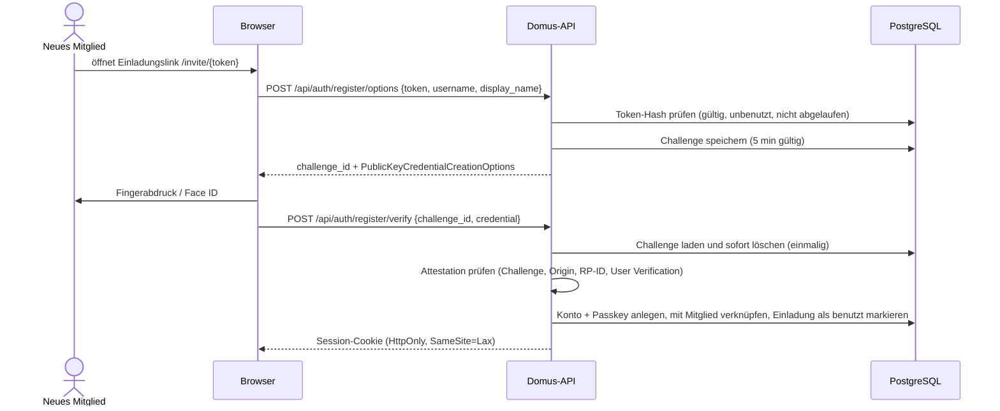
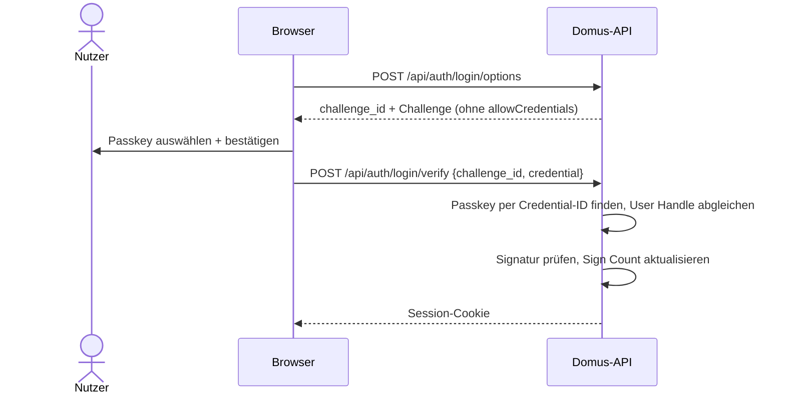

# Authentifizierung mit Passkeys

Domus verwendet **ausschließlich Passkeys** (WebAuthn/FIDO2). Es gibt keine Passwörter, die
vergessen, wiederverwendet oder gestohlen werden können. Auf dem Handy reicht Fingerabdruck oder
Gesichtserkennung.

> **Stand:** Backend und Tests sind fertig. Die Anmeldung ist vorerst per Schalter
> (`AUTH_ENABLED=false`) abgeschaltet, bis Domus mit HTTPS und fester Domain auf dem Raspberry Pi
> läuft – Passkeys sind an die Domain gebunden. Bis dahin gilt jede Anfrage als ältestes
> Mitglied des Haushalts; der Login im Frontend folgt als Nächstes.

## Grundprinzip

- Der **private Schlüssel** verlässt nie das Gerät des Nutzers.
- Der Server speichert nur den **öffentlichen Schlüssel** und prüft damit Signaturen.
- Jeder Passkey ist an die Domain (**RP-ID**) gebunden: Phishing-Seiten können ihn nicht nutzen.

## Neues Mitglied per Einladung

Registrieren kann sich nur, wer einen Einladungslink hat. Eine Einladung gehört immer zu einem
bestehenden **Mitglied** des Haushalts: Wer sich damit registriert, legt ein Konto an, das mit
genau diesem Mitglied verknüpft wird – alle bisherigen Ausgaben und Fixkosten der Person gehören
dann zu ihrem Konto. Den Link für das erste Mitglied erzeugt der Server-Betreiber per CLI
(`domus create-household "Familie Muster" "Anna"`), weitere erstellen Mitglieder über
`POST /api/household/members/{id}/invite`. Ist das Mitglied bereits verknüpft, wird jede weitere
Einladung für es ungültig.

## Anmeldung ohne Benutzername

Passkeys werden als **Discoverable Credentials** angelegt. Der Browser bietet die passenden Passkeys
selbst an – niemand muss einen Benutzernamen eintippen.

## Kontowiederherstellung

Ohne Passwort braucht es einen sicheren Notfallweg, falls jemand alle Geräte verliert:

1. **Mehrere Passkeys pro Person** (z. B. Handy + Laptop) – der letzte lässt sich nicht löschen.
2. **Wiederherstellungslink per CLI** für den Server-Betreiber:
   `domus create-recovery-link <benutzername>` erzeugt einen einmaligen Link, **1 Stunde** gültig,
   über den ein neuer Passkey registriert wird. Wer Zugriff auf den Server hat, kann so jedem
   (auch sich selbst) wieder Zugang verschaffen.

## Sicherheitsmaßnahmen im Detail

| Maßnahme                        | Umsetzung                                                                                                                                                  |
| ------------------------------- | ---------------------------------------------------------------------------------------------------------------------------------------------------------- |
| Keine Klartext-Tokens in der DB | Session-, Einladungs- und Wiederherstellungs-Tokens werden nur als SHA-256-Hash gespeichert. Ein Datenbank-Leak verrät keine gültigen Links oder Sessions. |
| Einmalige Challenges            | Jede Challenge wird beim Prüfen sofort gelöscht – auch bei Fehlschlag. Replay-Angriffe scheitern.                                                          |
| Kurzlebige Challenges           | 5 Minuten gültig; abgelaufene werden beim Anlegen neuer aufgeräumt.                                                                                        |
| User Verification Pflicht       | Biometrie oder Geräte-PIN ist bei Registrierung und Anmeldung erforderlich.                                                                                |
| Origin- und RP-ID-Prüfung       | Antworten von fremden Seiten werden abgelehnt (per Test abgesichert).                                                                                      |
| Eigenes User Handle             | WebAuthn erhält eine zufällige 64-Byte-ID statt der internen Benutzer-ID.                                                                                  |
| Sichere Cookies                 | `HttpOnly`, `SameSite=Lax`, im Betrieb `Secure`; gleitender Ablauf nach 30 Tagen Inaktivität.                                                              |
| Haushaltsgrenzen                | Einladungen nur für Mitglieder des eigenen Haushalts; ein Link verfällt, sobald das Mitglied verknüpft ist (per Test abgesichert).                         |

## Testbarkeit

Passkey-Abläufe lassen sich normalerweise nur mit echter Hardware oder im Browser testen. Domus
enthält dafür einen kleinen [Software-Authenticator](../code/backend/tests/softauthn.py), der
echte, kryptografisch signierte WebAuthn-Antworten (ES256, Attestation `none`) erzeugt. Damit
laufen alle Abläufe als schnelle, automatisierte Tests gegen eine echte PostgreSQL-Datenbank:
Registrierung, Anmeldung, Abmeldung, wiederverwendete Challenges, falsche Origin, unbekannte
Passkeys, Passkeys hinzufügen und löschen, Wiederherstellung sowie Einladung und Verknüpfung
von Mitgliedern.
→ [Tests](../code/backend/tests/test_auth.py)
