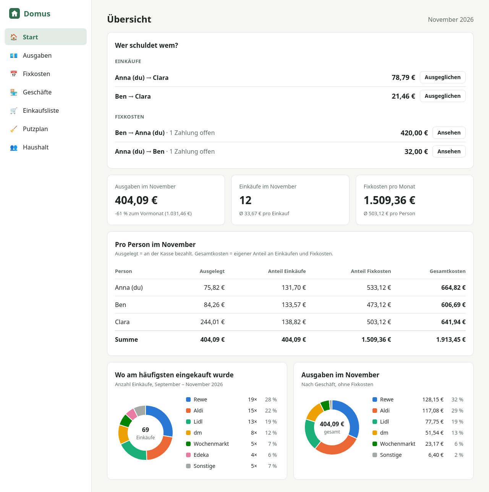
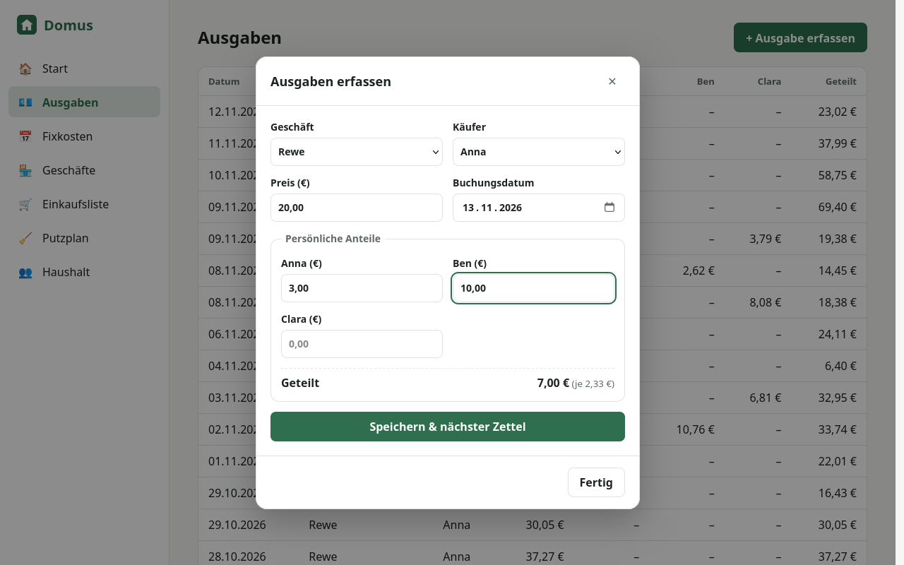
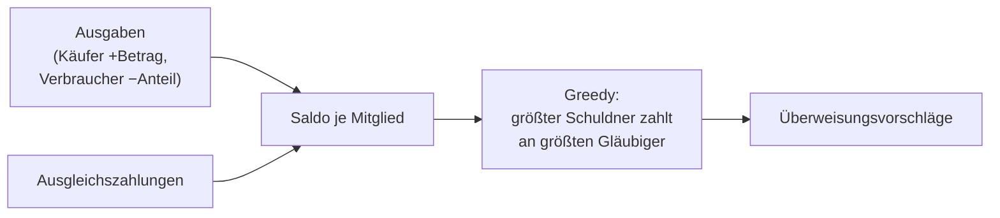
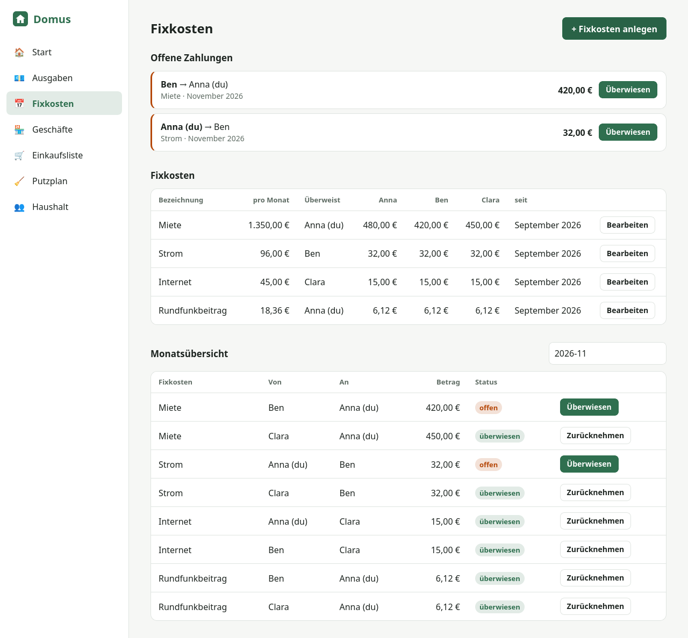
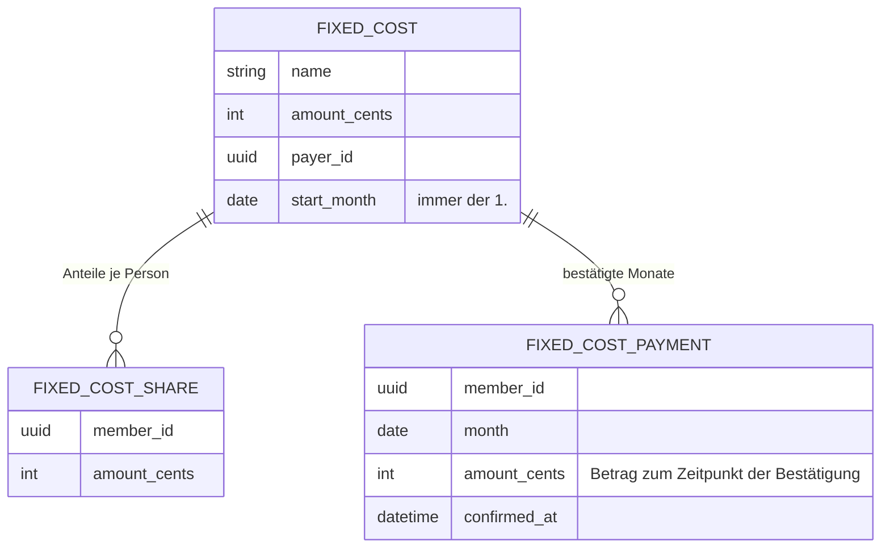
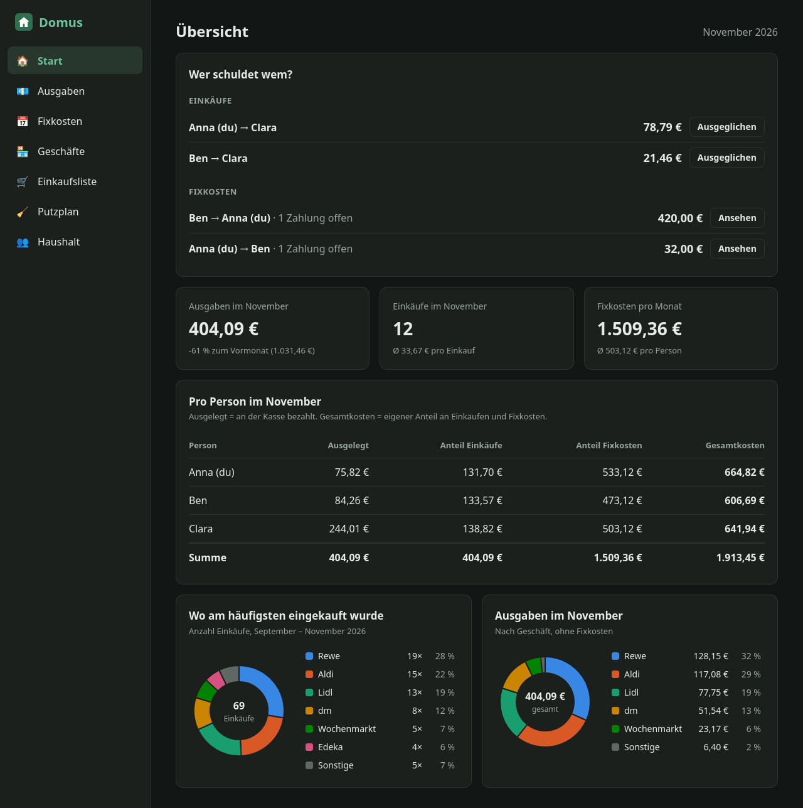

# Ausgaben, Abrechnung und Fixkosten

Der erste fachliche Bereich von Domus: Wer im Haushalt hat was bezahlt, wer schuldet wem wie viel,
und welche monatlichen Fixkosten sind noch offen?



## Begriffe

| Begriff                 | Bedeutung                                                                                            |
| ----------------------- | ---------------------------------------------------------------------------------------------------- |
| **Mitglied**            | Eine Person im Haushalt. Existiert unabhängig von einem Login-Konto (siehe unten).                   |
| **Geschäft**            | Wo eingekauft wurde (Rewe, Aldi, Wochenmarkt …), je Haushalt eindeutig.                              |
| **Ausgabe**             | Ein Kassenzettel: Geschäft, Käufer, Betrag, Buchungsdatum.                                           |
| **Persönlicher Anteil** | Teil eines Kassenzettels, der nur einer Person gehört (z. B. ihr Shampoo).                           |
| **Ausgleich**           | Eine Überweisung zwischen zwei Mitgliedern, die Einkaufsschulden begleicht.                          |
| **Fixkosten**           | Monatliche Kosten (Miete, Strom), die ein Mitglied komplett überweist und die anderen ihm erstatten. |

## Ausgaben erfassen



Der Dialog ist auf das Abtippen eines **Stapels von Kassenzetteln** ausgelegt: Nach dem Speichern
erscheint der Zettel als Zusammenfassung, und ein leeres Formular für den nächsten öffnet sich.
Käufer und Datum bleiben dabei stehen, weil sie sich innerhalb eines Stapels selten ändern.

Ein Kassenzettel wird so aufgeteilt:

```
20,00 € bei Rewe, bezahlt von Anna
  − 3,00 € persönlicher Anteil Anna
  − 10,00 € persönlicher Anteil Ben
  = 7,00 € geteilt → je 2,33 € (Anna 2,34 €, Ben 2,33 €, Clara 2,33 €)
```

- Beträge werden durchgehend als **ganze Cent** (`int`) gespeichert und gerechnet, nie als
  Gleitkommazahl.
- Beim Aufteilen geht **kein Cent verloren**: `split_evenly(701, 2) == [351, 350]`.
- Persönliche Anteile dürfen den Betrag nicht übersteigen; das prüfen Pydantic-Validierung,
  Datenbank-Constraints (`CHECK amount_cents > 0`) und das Formular.
- Wer **später einzieht**, erbt keine alten Kosten: Der geteilte Betrag wird nur unter den
  Mitgliedern aufgeteilt, die beim Erfassen schon im Haushalt waren.

## Wer schuldet wem? – minimale Überweisungen

Aus allen Ausgaben und Ausgleichszahlungen ergibt sich pro Mitglied ein **Saldo**: positiv, wenn
andere ihm Geld schulden, negativ, wenn es selbst schuldet. Statt jede einzelne Ausgabe paarweise
zu verrechnen, berechnet Domus daraus möglichst wenige Überweisungen:



```python
def minimal_transfers(balance: dict[uuid.UUID, int]) -> list[TransferOut]:
    """Greedy settlement: the largest debtor pays the largest creditor, and so on."""
```

Bei _n_ Mitgliedern entstehen höchstens _n − 1_ Überweisungen. Mit **„Ausgeglichen“** wird eine
Überweisung als Ausgleich gespeichert; der Saldo wird dadurch null, ohne dass Ausgaben verändert
oder gelöscht werden. Die Historie bleibt vollständig erhalten.
→ [Code](../code/backend/services/dashboard.py) · [Tests](../code/backend/tests/test_dashboard.py)

## Fixkosten



Typischer WG-Fall: Anna überweist die gesamte Miete an den Vermieter, Ben und Clara überweisen ihr
jeden Monat ihren Anteil. Domus bildet das so ab:

- Jede Fixkosten-Position hat einen **Zahler**, einen Monatsbetrag, einen Startmonat und
  **individuelle Anteile** pro Person (z. B. unterschiedlich große Zimmer).
- Aus Startmonat und Anteilen ergeben sich die **Fälligkeiten** pro Person und Monat – sie werden
  nicht gespeichert, sondern berechnet. Gespeichert wird nur die **Bestätigung** einer Überweisung.
- **Preisänderungen** (neuer Stromabschlag) gelten für alle offenen Monate; bereits bestätigte
  Monate behalten ihren damaligen Betrag, weil er bei der Bestätigung mitgespeichert wird.
- Versehentliche Bestätigungen lassen sich zurücknehmen.



→ [Code](../code/backend/services/fixed_costs.py) · [Modell](../code/backend/models/fixed_cost.py)

## Startseite (Dashboard)

Ein einziger Endpunkt (`GET /api/dashboard`) liefert alles, was die Startseite braucht:

- **Wer schuldet wem?** getrennt nach Einkäufen (minimale Überweisungen) und offenen Fixkosten
- **Kennzahlen:** Ausgaben im Monat mit Vergleich zum Vormonat, Anzahl Einkäufe mit Durchschnitt,
  Fixkosten pro Monat und Person
- **Pro Person:** was jemand an der Kasse ausgelegt hat, sein tatsächlicher Anteil an Einkäufen
  und Fixkosten, Gesamtkosten
- **Zwei Ringdiagramme:** Einkäufe der letzten drei Monate nach Häufigkeit, Ausgaben des Monats
  nach Geschäft

Die Diagramme sind **ohne Chart-Bibliothek** als eigene SVG-Komponente gebaut
([DonutChart.tsx](../code/frontend/DonutChart.tsx)):

- Die Legende ist gleichzeitig Tabelle (Name, Wert, Anteil); die Zuordnung hängt nie allein an der
  Farbe, und das SVG hat eine vollständige Textbeschreibung für Screenreader.
- Ein Geschäft hat in **beiden Diagrammen dieselbe Farbe**; die sechs wichtigsten Geschäfte
  bekommen feste Farbplätze, der Rest wird zu „Sonstige“ zusammengefasst
  ([storeColors.ts](../code/frontend/storeColors.ts)).
- Die Farbpalette ist für Hell- und Dunkelmodus abgestimmt.



## Testabdeckung

Die Rechenlogik ist gegen eine echte PostgreSQL-Datenbank getestet, u. a.:

- das Beispiel vom Kassenzettel (persönliche Anteile + geteilter Rest)
- Cent-genaues Aufteilen und minimale Überweisungen
- Mitglieder, die später einziehen, zahlen nicht für alte Einkäufe
- Ausgleichszahlungen bringen den Saldo auf null
- Fixkosten: keine Fälligkeit für den Zahler selbst und vor dem Startmonat, Preisänderung behält
  bestätigte Beträge, Bestätigen und Zurücknehmen
- Zugriff auf Daten eines fremden Haushalts wird abgelehnt

Im Frontend prüfen Tests mit Testing Library die Seiten aus Nutzersicht (Rollen, Beschriftungen,
Klicks) gegen ein simuliertes Backend.
